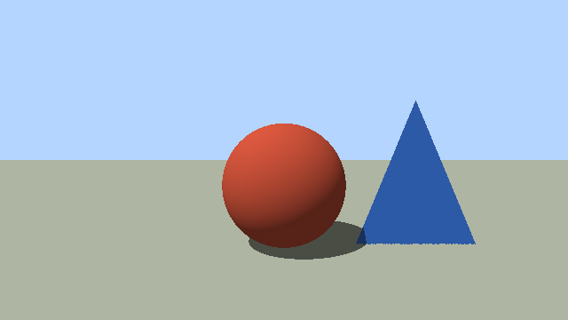

# Raytracer

A C++20 student ray tracer for HETIC, developed from Kevin Glass's
[course](https://learn.glassworks.tech/raytracer/).

The m2 implementation adds a blue triangle beside the matte sphere on its floor,
with directional sunlight, hard shadows and a sky background. `make run` saves a
real JPEG. The preview below is an unchanged copy of that output.



The [original m1 preview](docs/images/m1-preview.png), discovery report and
existing milestone tags are preserved.

## Development environment

Install Docker and VS Code's Dev Containers extension. On Windows, keep the
repository inside WSL and enable that distribution in Docker Desktop's WSL
integration settings. Open the repository and select **Dev Containers: Reopen in
Container**. Docker must be running. The first configure downloads Catch2 from
GitHub and requires internet access.

Inside the container, from the repository root:

```sh
make build
make run
make test
make clean
```

`make run` creates `render.jpg` (640 × 360) in the repository root. Open it with an
ordinary image viewer. Generated files and build caches are ignored by Git.
`make clean` removes compiled targets but keeps the CMake cache and downloaded
Catch2, so subsequent builds need not download it again.

To choose a path and resolution after building:

```sh
./build/unix-debug/raytracer build/custom.jpg 1280 720
./build/unix-debug/raytracer --help
make test PRESET=unix-release
```

The CLI accepts `raytracer [output.jpg [width height]]`; both dimensions must be
integers from 1 to 4096. Output folders must already exist. Invalid arguments and
file errors return a nonzero exit status. File contents are always JPEG at quality
95, regardless of the chosen extension. The old PPM library remains available and
tested; the CLI now selects JPEG.

CMake describes the build, Catch2 provides C++ assertions, and CTest discovers
and runs the tests. The Makefile wraps those tools in short commands. No external
library is required at runtime.

Without Docker, install a C++20 compiler, Git, Make and CMake 3.25 or newer.
Use a separate build directory so that the container never reuses a host cache:

```sh
cmake -S . -B build/host-validation -DCMAKE_BUILD_TYPE=Debug
cmake --build build/host-validation --parallel 2
ctest --test-dir build/host-validation --output-on-failure
./build/host-validation/raytracer
```

On native Windows, install Visual Studio 2022 with **Desktop development with
C++**, CMake 3.25+ and Git, then use the presets directly:

```powershell
cmake --preset windows
cmake --build --preset windows-debug
ctest --preset windows-debug
.\build\windows\Debug\raytracer.exe render.jpg 640 360
```

Native Windows/macOS builds are provided as configurations but have not been
validated. The supported shared development environment is the Linux container.

## Tests and decisions

Use TDD: write a test with expected values calculated independently, observe the
failure, implement the smallest change, then refactor with the tests green.
Add each new test file explicitly to `tests/CMakeLists.txt`.

There are 50 Catch2 cases plus one CLI integration test. They cover vector maths,
ray parameters, sphere/plane/triangle intersections, closest-hit selection, camera
pixel centres, image bounds, PPM/JPEG encoding, sunlight, shadows and command-line
errors. JPEG tests decode real files and allow small documented lossy errors.
See the [TDD record](docs/engineering/tdd-log.md) and
[engineering review](docs/engineering/review.md). The
[validation record](docs/engineering/validation.md) includes successful Debug and
Release checks of m1 in WSL and in a fresh copy inside the Docker image. The
[m2 validation record](docs/engineering/m2-validation.md) records the new TDD
observations, current checks and the reasons for changing existing files.

Architecture decisions are recorded in [docs/adr](docs/adr/README.md). Drafts stay
`Proposed` until the project owner reads and accepts them. AI instructions live in
[AGENTS.md](AGENTS.md). The original [m0 report](docs/discovery/discovery-report.md)
is preserved.

## Project map

```text
src/
  main.cpp       command-line parsing and demonstration scene
  math/          3D vectors
  geometry/      rays, hits and shapes (sphere, plane and triangle)
  image/         linear RGB pixels and separate PPM/JPEG encoding
  render/        camera, scene ownership and sunlight rendering
tests/           mirrors the source domains, plus CLI checks
docs/
  adr/           proposed architecture decisions
  domain/        UML model and rendering contracts
  engineering/   TDD observations and code review
  milestones/    m1 and m2 delivery checklists
third_party/     pinned stb headers with their original licence notices
```

The [domain model](docs/domain/domain-model.md) explains the coordinates and maths.
The camera faces -Z with +Y up; one ray passes through each pixel centre. Shadows
use an extra ray towards the sun. Shading is Lambertian with a small ambient term;
the file adapters clamp and gamma encode the final linear colour. stb is isolated
behind `save_jpeg`; the rendering loop has no dependency on file formats.

The scope is deliberately small: fixed camera orientation, one sample per pixel,
no reflections, indirect illumination, acceleration structure or parallelism.
The intersection epsilon assumes the demo's world scale. Triangle intersection
uses Moller-Trumbore, accepts both faces and includes edges and vertices; it is
not a watertight mesh intersection algorithm for extreme coordinate scales.

## Contributing and delivery

Read [CONTRIBUTING.md](CONTRIBUTING.md) and the
[code of conduct](CODE_OF_CONDUCT.md). Issue and pull request templates live under
`.github/`. [CI](.github/workflows/ci.yml) builds the development Dockerfile and
runs tests and a small render in Debug and Release. A successful local run does
not establish that a hosted workflow has passed.

The [m2 checklist](docs/milestones/m2.md) separates the implementation from final
review, ADR acceptance and Git delivery. It also records the historical m1 gaps
against the published course. The project owner must be able to explain and
defend the decisions before tagging the milestone.

Licensed under [MIT](LICENSE), as selected by the project owner. Dependencies
retain their own licences.
