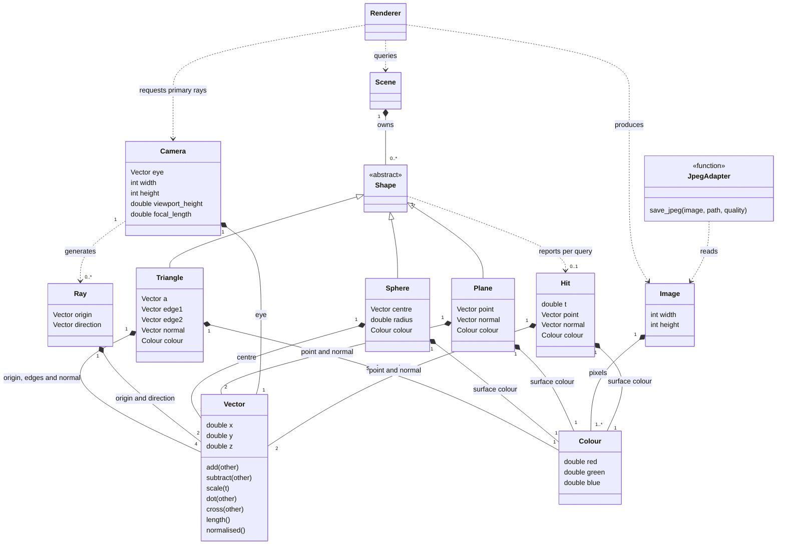

# Domain model

This model follows the [client's explanation](https://learn.glassworks.tech/raytracer/understanding-the-domain/)
and distinguishes spatial vectors from RGB colours. It describes the implemented
m2 extension; the owner must review its decisions in [the ADRs](../adr/README.md).

Composition here means owned values, not shared identity. Every Image contains
exactly width × height Colours. Every rendered pixel has one camera ray; additional
shadow rays are generated by Renderer. The screen is derived from the camera's
viewport dimensions and focal length, so no separate screen class is stored.
Vector operations are shown because they are the domain's mathematics. In code,
add/subtract/scale are `+`, `-` and scalar-left `*`.

## Contracts and coordinates

- +X points right, +Y up, and the camera looks along -Z. Pixel rows run downwards.
- A ray is `P(t) = origin + t * direction`. A nonunit direction is permitted;
  its t is not a distance. Camera and shadow directions have length one.
- A shape returns its smallest t strictly inside the requested interval. Scene
  compares those values to find the first visible surface, regardless of order.
- Sphere normals point outward. A plane normal keeps its configured orientation.
- Triangle normals follow `normalise((b-a) cross (c-a))` and keep that orientation
  on both faces. Edges and vertices are included; collinear, repeated or non-finite
  vertices are rejected. Ray-parallel triangles miss. Moller-Trumbore uses an
  exact zero determinant check (as Plane does for its denominator), avoiding an
  absolute tolerance that would depend on ray direction length or triangle size.
  Near-parallel rays and shared mesh edges at extreme scales need a future robust
  intersection policy; no watertight guarantee is claimed.
- Colour stores linear RGB; only the PPM and JPEG adapters clamp and gamma encode
  it. JPEG quality defaults to 95; decoding may slightly change pixel values.

## Rendering

For each pixel, find the first hit. A miss returns sky colour (0.5, 0.7, 1). For
a hit, let n be its unit normal and L the direction towards the sun. If the shadow
ray hits another surface, direct light is zero. Otherwise it is max(0, n · L).
Multiply the surface colour by `0.15 + 0.85 * direct_light`.

The demonstration uses a radius-1 sphere centred at (0, 1, 0), a floor at y = 0,
an eye at (0, 1.4, 4), and sunlight towards (-1, 2, 1). The sphere therefore touches
the floor at y = 0. m2 adds a triangle with corners (1.2, 0, 0), (3.2, 0, 0)
and (2.2, 2.4, 0), with a +Z normal and blue surface colour. Shape, Hit, Scene,
Camera and Renderer keep their m1 interfaces.
